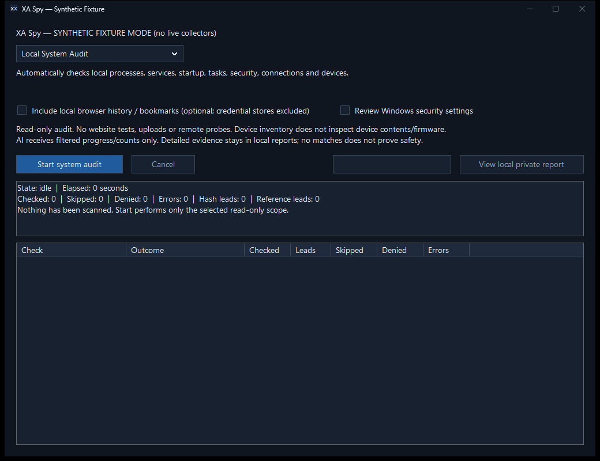
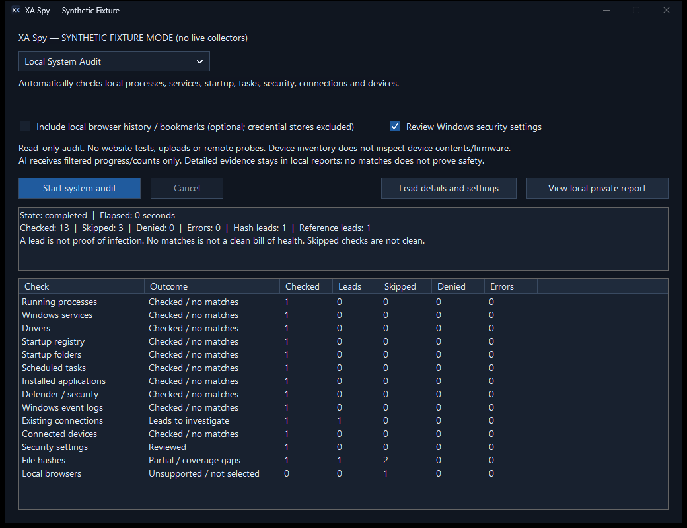

# XA Spy

XA Spy is a native Windows x64 app for investigating known indicators of compromise. It compares executable hashes and optional browser references with two bundled indicator feeds. Run a read-only audit of the current computer or narrow the check to a selected folder. The app runs locally and requires no account or Python runtime.

## Quick start

1. Place `XASpy.exe` and its companion `iocs/` folder together in a writable, nonsynced local folder. If you have a source checkout, build the app using the instructions below.
2. Open `XASpy.exe` and choose a scope. **Local System Audit** reviews Windows records. **Selected Folder Scan** checks supported files under a directory you choose. Browser checks are off by default.
3. Press **Start**. Review the leads alongside skipped items, access denials, and errors. Select **View local private report** for the evidence behind a result. **Cancel** requests a cooperative stop and preserves results collected so far.



## What it checks

| Scope | Evidence |
| --- | --- |
| Windows system | Processes, services, drivers, startup entries, scheduled tasks, installed apps, security status, selected event metadata, existing network connections, and device metadata. |
| Executable files | SHA-256 hashes for EXE, DLL, SYS, SCR, MSI, and COM files up to 120 MiB each. The selected-folder scope uses the same hash checks. |
| Optional security settings | In Local System Audit, select **Review Windows security settings** to inspect Remote Desktop host configuration, firewall profiles, Secure Boot, and BitLocker protection. Results appear in **Lead details and settings**. A disabled setting can warrant review without increasing the malware lead count. |
| Optional browser checks | Supported Chromium and Firefox history or bookmark artifacts. The reader extracts HTTP(S) hostnames and discards URL paths, queries, and titles. |

## When you see a lead

Start with the **Leads** column, then check **Skipped**, **Denied**, and **Errors** on the same row. In the synthetic run below, **File hashes** found one match and skipped two items. **Existing connections** found one reference. **Local browser** was off. These counts describe what the app observed and where its coverage ended. [Coverage and limits](docs/COVERAGE.md)



Select **Lead details and settings** to see each matched file or host, the evidence grade, the source, and a suggested next step. A host marked `reclaimable` may now belong to a different owner. Compare its observation with the date and context of the original report before acting.

For the underlying records, select **View local private report** and look for records with `"type":"indicator_match"`. Read `check` and `grade` to identify the kind of lead. The `artifact` field gives the local file, browser database, or network address involved. The `indicator`, `tier`, and `source` fields identify what matched and where the feed entry came from. Use the cited research to check the indicator’s context and date. Avoid opening a flagged file or visiting a flagged address.

| Report grade | What to look for next |
| --- | --- |
| `known_sample_hash` | Prioritize this match. The file’s SHA-256 matched a sample in the feed. Look for the **same full file path** in process, service, startup, or scheduled-task inventory. Check **Windows Security → Virus & threat protection → Protection history** for a detection naming that file. A matching file in Downloads establishes its presence. A running process at that path adds evidence that it ran. |
| `legitimate_vulnerable_driver_lead` | Identify the driver’s publisher and version in file properties and check the vendor’s advisory. A signed driver can be genuine and still vulnerable. If the vendor lists the installed version as affected, use its supported update procedure. |
| `observed_connection_reference` | Find the matching address in the **Existing connections** inventory from that run. Check the owning PID and available process path. A shared or reassigned IP can match unrelated traffic. A connection owned by the same executable that produced a sample-hash match warrants prompt investigation. |
| `browser_history_record` or `browser_reference` | Check which profile and artifact supplied the host. A bookmark can be saved or synced, and history can be imported. If a download is suspected, check the browser’s Downloads list locally for the filename, then check its folder with **Selected Folder Scan**. A URL reference alone cannot establish that a file ran. |

**When to escalate.** If a known-sample hash also appears as a running executable, or endpoint protection independently flags the same file, preserve the run and contact your security team promptly. On a work device, follow its incident-response procedure before changing anything. On a personal device with signs of active compromise, disconnect it from the network and seek help from a trusted device. Keep the private report off public issues. Record the run ID, grade, and corroborating observation so a reviewer knows what triggered the concern.

## Results and privacy

Each run writes unencrypted reports to `findings/{run-id}/` beside the executable. The detailed report, `private-evidence.jsonl`, and the readable review, `private-review.txt`, can contain identifying paths, names, and network addresses. Keep both files private. For progress or automation, use the filtered `progress.jsonl` and `summary.json` files. Git’s project allowlist excludes scan output, local work, backups, and builds. [Privacy](PRIVACY.md) · [Local CLI](docs/LOCAL-CONTROL.md)

## Build from source

On Windows, install Python 3.11 or later for the build helper, Visual Studio with the MSVC x64 C++ tools and Windows SDK, and CMake. Visual Studio 2022 requires CMake 3.24 or later. Visual Studio 2026 requires CMake 4.2 or later. Run this command from the repository root.

```powershell
python "1. build.py"
```

The executable and its companion `iocs/` folder are written to `out/native/Release/`. To build a separate copy and run synthetic native tests, use `python "1. build.py" --candidate --tests --no-pause`. Its output goes to `out/candidate/Release/`. [Validation procedures](docs/VALIDATION.md)

## Project and licensing

The Windows application lives in `native/`. The `scan/` directory retains the upstream Python toolkit for reference. XA Spy derives from Zero Breach Toolkit, based on commit `fceb0a6`. [Upstream project](https://github.com/interplains/Zero-Breach-Toolkit/tree/fceb0a6c151e792e2cc8cee7e54f4e10edebaa15)

The project software uses Apache License 2.0. Indicator data and bundled third-party material carry their own terms and source credits. [License](LICENSE) · [Notices](NOTICE) · [Indicator data terms](iocs/LICENSE.md) · [Third-party material](third_party/candiru/README.md)
